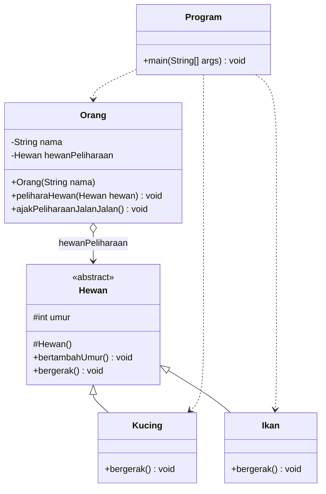
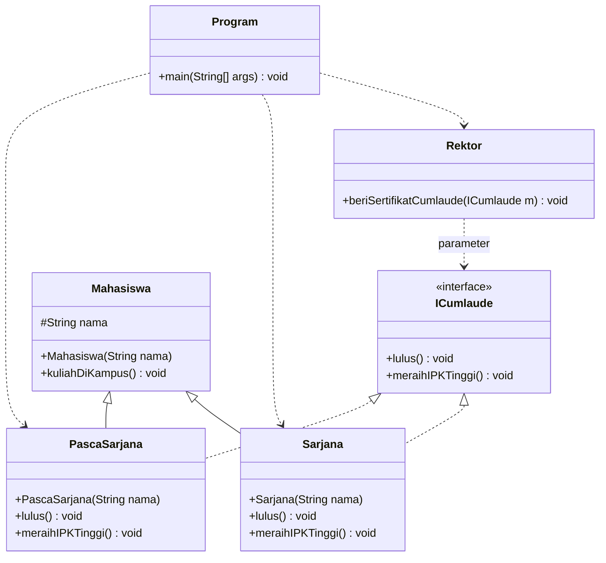
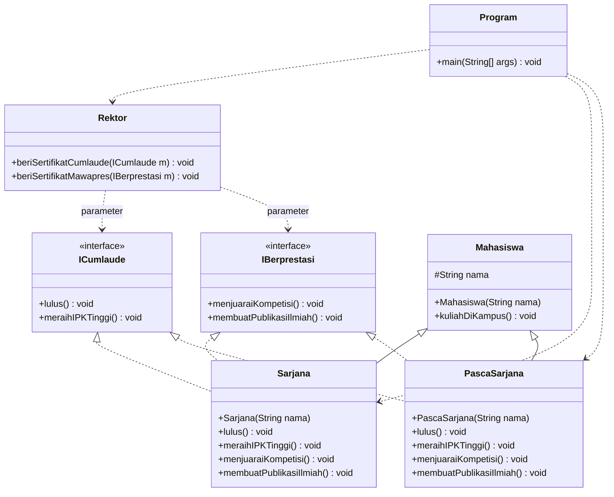
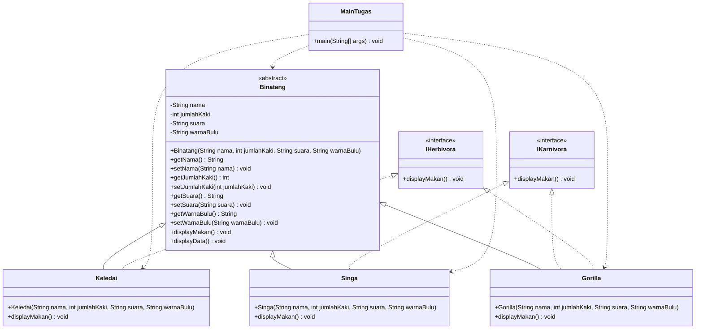

# LAPORAN PRAKTIKUM PEMROGRAMAN BERBASIS OBJEK
## Pertemuan 10: Abstract Class dan Interface

---

### Identitas Mahasiswa
- **Nama** : Ibni Andarta
- **Kelas** : TI-2G
- **NIM** : 254107020258
- **Mata Kuliah** : Praktikum Pemrograman Berbasis Objek (RTI253008)
- **Jurusan** : Teknologi Informasi - Politeknik Negeri Malang

---

## A. Ringkasan Materi & Teori

**Abstract class** adalah class yang **tidak dapat diinstansiasi** dengan `new`, tetapi dapat di-`extend`. Abstract class baru bermanfaat setelah ada subclass konkret yang meng-override seluruh abstract method-nya. **Interface** adalah **kontrak** berisi daftar method yang wajib dipenuhi class yang meng-`implements`-nya, sehingga class tersebut dianggap memiliki kemampuan tertentu.

| Aspek | Abstract Class | Interface |
| :--- | :--- | :--- |
| Isi method | Abstract method dan method biasa | Abstract method (Java 8+: `default`/`static`) |
| Modifier method | Ditulis sendiri (`public`, `protected`, dst.) | Otomatis `public abstract` |
| Atribut | Instance variable dan konstanta | Hanya konstanta (`public static final`) |
| Constructor | Ada | Tidak ada |
| Pewarisan | Satu class hanya boleh `extends` satu class | Satu class boleh `implements` banyak interface |
| Hubungan | "adalah" (*is-a*) — Kucing **adalah** Hewan | "dapat/bisa" (*can-do*) — Sarjana **dapat** Cumlaude |
| Instansiasi | Tidak bisa `new` | Tidak bisa `new` |

Kaidah penting yang diuji pada jobsheet ini:

1. Class yang memiliki minimal satu abstract method **wajib** dideklarasikan `abstract`.
2. Subclass konkret **wajib** meng-override **semua** abstract method induk; jika tidak, subclass tersebut juga harus `abstract`.
3. Method implementasi interface **wajib `public`**; menurunkan visibilitas menjadi *package-private* menghasilkan error *attempting to assign weaker access privileges*.
4. Interface tidak boleh memakai method `private`/`protected` yang abstract; method interface secara implisit `public`.
5. Interface dan abstract class **tidak dapat** dibuat objeknya dengan `new`.
6. **Notasi UML**: abstract class dan abstract method ditulis *miring*; interface diberi «interface»; `extends` = garis penuh dengan panah segitiga kosong; `implements` = garis putus-putus dengan panah segitiga kosong.

---

## B. Percobaan 1: Abstract Class

### 1. Deskripsi Singkat

Semua hewan memiliki kesamaan: umur bertambah satu setiap tahun (`bertambahUmur()`). Namun cara bergerak berbeda-beda, sehingga `bergerak()` dibuat **abstract** di class `Hewan` dan wajib di-override oleh `Kucing` serta `Ikan`. Class `Orang` menyimpan referensi `Hewan` sebagai hewan peliharaan, sehingga satu method `ajakPeliharaanJalanJalan()` dapat menangani hewan apa pun.



### 2. Kode Program

- **`Hewan.java`**
```java
package abstractclass;

public abstract class Hewan {
    protected int umur;

    protected Hewan() {
        this.umur = 0;
    }

    public void bertambahUmur() {
        this.umur += 1;
    }

    public abstract void bergerak();
}
```

- **`Kucing.java`**
```java
package abstractclass;

public class Kucing extends Hewan {
    @Override
    public void bergerak() {
        System.out.println("Berjalan dengan KAKI, \"tap..tap..\"");
    }
}
```

- **`Ikan.java`**
```java
package abstractclass;

public class Ikan extends Hewan {
    @Override
    public void bergerak() {
        System.out.println("Berenang dengan SIRIP, \"wush..wush..\"");
    }
}
```

- **`Orang.java`**
```java
package abstractclass;

public class Orang {
    private String nama;
    private Hewan hewanPeliharaan;

    public Orang(String nama) {
        this.nama = nama;
    }

    public void peliharaHewan(Hewan hewan) {
        this.hewanPeliharaan = hewan;
    }

    public void ajakPeliharaanJalanJalan() {
        System.out.println("Namaku " + this.nama);
        System.out.println("Hewan peliharaanku berjalan dengan cara: ");
        this.hewanPeliharaan.bergerak();
        System.out.println("----------------------------------------");
    }
}
```

- **`Program.java`**
```java
package abstractclass;

public class Program {
    public static void main(String[] args) {
        Kucing kucingKampung = new Kucing();
        Ikan lumbaLumba = new Ikan();

        Orang ani = new Orang("Ani");
        Orang budi = new Orang("Budi");

        ani.peliharaHewan(kucingKampung);
        budi.peliharaHewan(lumbaLumba);

        ani.ajakPeliharaanJalanJalan();
        budi.ajakPeliharaanJalanJalan();
    }
}
```

### 3. Output Eksekusi

```
Namaku Ani
Hewan peliharaanku berjalan dengan cara: 
Berjalan dengan KAKI, "tap..tap.."
----------------------------------------
Namaku Budi
Hewan peliharaanku berjalan dengan cara: 
Berenang dengan SIRIP, "wush..wush.."
----------------------------------------
```

### 4. Tabel Pengamatan Eksperimen

| No | Perubahan | Hasil kompilasi |
| :---: | :--- | :--- |
| 1 | Tambahkan `Hewan hewan = new Hewan();` pada `main()` | `Program.java:7: error: Hewan is abstract; cannot be instantiated` |
| 2 | Hapus method `bergerak()` dari `Ikan` | `Ikan.java:3: error: Ikan is not abstract and does not override abstract method bergerak() in Hewan` |
| 3 | Tambahkan `public abstract void bernapas();` di `Ikan` | `Ikan.java:3: error: Ikan is not abstract and does not override abstract method bernapas() in Ikan` |

### 5. Jawaban Pertanyaan Percobaan 1

**1. Mengapa `this.hewanPeliharaan.bergerak()` di class `Orang` menghasilkan output berbeda untuk Ani dan Budi?**  
**Jawab:** Karena `hewanPeliharaan` adalah **referensi polimorfik** bertipe `Hewan`, sedangkan objek yang ditunjuk berbeda: milik Ani adalah `Kucing`, milik Budi adalah `Ikan`. Saat `bergerak()` dipanggil, compiler hanya mengenali method `Hewan.bergerak()`, tetapi JVM memilih versi *override* berdasarkan **tipe objek sebenarnya** (*virtual method invocation* / *dynamic method dispatch*). Karena itu satu pernyataan yang sama dapat menghasilkan perilaku berbeda.

**2. Tambahkan `Hewan hewan = new Hewan();` pada `main()`. Tunjukkan hasil kompilasinya dan jelaskan.**  
**Jawab:** Hasil kompilasi:
```
Program.java:7: error: Hewan is abstract; cannot be instantiated
        Hewan hewan = new Hewan();
                      ^
1 error
```
`Hewan` dideklarasikan `abstract` karena memiliki method `bergerak()` yang belum memiliki badan. Abstract class memang tidak boleh dibuat objeknya. Constructor `protected Hewan()` tetap ada, tetapi hanya dapat dipanggil dari subclass melalui `super()`, bukan dari luar hierarki.

**3. Bolehkah class yang meng-extend abstract class tidak mengimplementasikan abstract method induknya? Buktikan dengan menghapus `bergerak()` dari `Ikan`.**  
**Jawab:** **Tidak boleh**, selama class tersebut konkret. Hasil kompilasi:
```
Ikan.java:3: error: Ikan is not abstract and does not override abstract method bergerak() in Hewan
public class Ikan extends Hewan {}
       ^
1 error
```
Aturan yang dilanggar: class konkret wajib meng-override seluruh abstract method yang diwarisinya. Jika `Ikan` memang ingin tetap tidak mengimplementasikan `bergerak()`, deklarasinya harus diubah menjadi `public abstract class Ikan extends Hewan`, sehingga kewajiban itu diteruskan ke subclass berikutnya.

**4. Tambahkan `public abstract void bernapas();` di dalam class `Ikan` tanpa mengubah deklarasi class. Tunjukkan hasil kompilasi dan aturan yang dilanggar.**  
**Jawab:** Hasil kompilasi:
```
Ikan.java:3: error: Ikan is not abstract and does not override abstract method bernapas() in Ikan
public class Ikan extends Hewan {
       ^
1 error
```
Ada dua aturan yang dilanggar: (a) class yang memiliki abstract method **wajib** dideklarasikan `abstract`, sedangkan `Ikan` masih `public class`; (b) sebagai class konkret, `Ikan` wajib mengimplementasikan abstract method yang baru ditambahkan. Perbaikannya adalah menambahkan badan method `bernapas()` atau mengubah `Ikan` menjadi abstract class.

---

## C. Percobaan 2: Interface

### 1. Deskripsi Singkat

Rektor memberikan sertifikat Cumlaude hanya kepada mahasiswa yang memenuhi kontrak `ICumlaude`, yaitu `lulus()` dan `meraihIPKTinggi()`. `Sarjana` dan `PascaSarjana` sama-sama **adalah** `Mahasiswa` (`extends`), tetapi kemampuan menjadi Cumlaude diperoleh melalui **implements** interface. Method `Rektor.beriSertifikatCumlaude()` menerima parameter bertipe interface, sehingga hanya objek yang memenuhi kontrak yang dapat diproses.



### 2. Kode Program

- **`ICumlaude.java`**
```java
package interfacelatihan;

public interface ICumlaude {
    public abstract void lulus();

    public abstract void meraihIPKTinggi();
}
```

- **`Mahasiswa.java`**
```java
package interfacelatihan;

public class Mahasiswa {
    protected String nama;

    public Mahasiswa(String nama) {
        this.nama = nama;
    }

    public void kuliahDiKampus() {
        System.out.println("Aku mahasiswa, namaku " + this.nama);
        System.out.println("Aku berkuliah di kampus.");
    }
}
```

- **`Sarjana.java`**
```java
package interfacelatihan;

public class Sarjana extends Mahasiswa implements ICumlaude {
    public Sarjana(String nama) {
        super(nama);
    }

    @Override
    public void lulus() {
        System.out.println("Aku sudah menyelesaikan SKRIPSI");
    }

    @Override
    public void meraihIPKTinggi() {
        System.out.println("IPK-ku lebih dari 3,51");
    }
}
```

- **`PascaSarjana.java`**
```java
package interfacelatihan;

public class PascaSarjana extends Mahasiswa implements ICumlaude {
    public PascaSarjana(String nama) {
        super(nama);
    }

    @Override
    public void lulus() {
        System.out.println("Aku sudah menyelesaikan TESIS");
    }

    @Override
    public void meraihIPKTinggi() {
        System.out.println("IPK-ku lebih dari 3,71");
    }
}
```

- **`Rektor.java`**
```java
package interfacelatihan;

public class Rektor {
    public void beriSertifikatCumlaude(ICumlaude mahasiswaCumlaude) {
        System.out.println("Saya REKTOR, memberikan sertifikat cumlaude.");
        System.out.println("Selamat! Silakan perkenalkan diri Anda..");

        mahasiswaCumlaude.lulus();
        mahasiswaCumlaude.meraihIPKTinggi();

        System.out.println("----------------------------------------");
    }
}
```

- **`Program.java`** (setelah diperbaiki)
```java
package interfacelatihan;

public class Program {
    public static void main(String[] args) {
        Rektor pakRektor = new Rektor();

        Sarjana sarjanaCumlaude = new Sarjana("Dini");
        PascaSarjana masterCumlaude = new PascaSarjana("Elok");

        pakRektor.beriSertifikatCumlaude(sarjanaCumlaude);
        pakRektor.beriSertifikatCumlaude(masterCumlaude);
    }
}
```

Saat masih mengikuti langkah 6, `Program` juga membuat `Mahasiswa mhsBiasa = new Mahasiswa("Charlie");` lalu memanggil `pakRektor.beriSertifikatCumlaude(mhsBiasa);`. Baris inilah yang menyebabkan error pada langkah 7 dan kemudian dihapus.

### 3. Error pada Langkah 7 dan Perbaikannya

Pesan error saat `mhsBiasa` masih dikirim ke `beriSertifikatCumlaude()`:

```
Program.java:10: error: incompatible types: Mahasiswa cannot be converted to ICumlaude
        pakRektor.beriSertifikatCumlaude(mhsBiasa);
                                         ^
1 error
```

**Penyebab:** parameter method bertipe interface `ICumlaude`, sedangkan `Mahasiswa` **tidak meng-implements** interface tersebut. Menjadi `Mahasiswa` tidak otomatis membuat seseorang memenuhi kontrak Cumlaude.

**Perbaikan:** hapus (atau komentar) pemanggilan untuk `mhsBiasa`, sehingga hanya `Sarjana` dan `PascaSarjana` — yang benar-benar meng-implements `ICumlaude` — yang menerima sertifikat.

### 4. Output Eksekusi

```
Saya REKTOR, memberikan sertifikat cumlaude.
Selamat! Silakan perkenalkan diri Anda..
Aku sudah menyelesaikan SKRIPSI
IPK-ku lebih dari 3,51
----------------------------------------
Saya REKTOR, memberikan sertifikat cumlaude.
Selamat! Silakan perkenalkan diri Anda..
Aku sudah menyelesaikan TESIS
IPK-ku lebih dari 3,71
----------------------------------------
```

### 5. Tabel Pengamatan Eksperimen

| No | Perubahan | Hasil kompilasi |
| :---: | :--- | :--- |
| 1 | Kirim `mhsBiasa` (bertipe `Mahasiswa`) ke `beriSertifikatCumlaude(ICumlaude)` | `incompatible types: Mahasiswa cannot be converted to ICumlaude` |
| 2 | Hapus `public` pada `Sarjana.lulus()` | `lulus() in Sarjana cannot implement lulus() in ICumlaude`<br>`attempting to assign weaker access privileges; was public` |

### 6. Jawaban Pertanyaan Percobaan 2

**1. Mengapa pada langkah 7 terjadi error? Tuliskan pesan error dan jelaskan cara memperbaikinya.**  
**Jawab:** Error terjadi karena `beriSertifikatCumlaude()` hanya menerima objek bertipe `ICumlaude`, sementara `mhsBiasa` bertipe `Mahasiswa` yang tidak meng-implements `ICumlaude`. Pesan errornya:
```
incompatible types: Mahasiswa cannot be converted to ICumlaude
```
Perbaikannya: hapus pemanggilan `beriSertifikatCumlaude(mhsBiasa)`, atau bila memang diinginkan, buat class turunan `Mahasiswa` yang meng-implements `ICumlaude`. Yang penting, hanya objek yang memenuhi kontrak interface yang boleh dikirim ke parameter tersebut.

**2. Dapatkah method `kuliahDiKampus()` dipanggil dari objek `sarjanaCumlaude` di class `Program`? Mengapa?**  
**Jawab:** **Dapat.** `sarjanaCumlaude` dideklarasikan bertipe `Sarjana`, dan `Sarjana extends Mahasiswa`. Method `kuliahDiKampus()` diwarisi secara `public`, sehingga menjadi bagian dari anggota `Sarjana` dan boleh dipanggil langsung: `sarjanaCumlaude.kuliahDiKampus();`.

**3. Dapatkah method `kuliahDiKampus()` dipanggil dari parameter `mahasiswaCumlaude` di method `beriSertifikatCumlaude()` pada class `Rektor`? Mengapa?**  
**Jawab:** **Tidak dapat.** Tipe referensi parameter adalah `ICumlaude`, dan interface tersebut hanya mendeklarasikan `lulus()` serta `meraihIPKTinggi()`. Compiler tidak mengenal `kuliahDiKampus()` pada tipe `ICumlaude`, sehingga muncul `cannot find symbol`. Agar bisa dipanggil, parameter harus di-downcast lebih dulu, misalnya:
```java
if (mahasiswaCumlaude instanceof Mahasiswa mhs) {
    mhs.kuliahDiKampus();
}
```

**4. Hapus kata kunci `public` pada method `lulus()` di class `Sarjana`. Tunjukkan hasil kompilasi dan jelaskan.**  
**Jawab:** Hasil kompilasi:
```
Sarjana.java:9: error: lulus() in Sarjana cannot implement lulus() in ICumlaude
    void lulus() {
         ^
  attempting to assign weaker access privileges; was public
1 error
```
Method di dalam interface otomatis bersifat `public abstract`. Implementasinya tidak boleh menurunkan visibilitas menjadi *package-private* (tanpa modifier), karena itu berarti method tidak lagi memenuhi kontrak `public` dari interface. Aturannya: visibilitas method implementasi harus **sama atau lebih luas** dari method interface.

---

## D. Percobaan 3: Multiple Interface

### 1. Deskripsi Singkat

Selain Cumlaude, Rektor juga memberi sertifikat Mawapres kepada mahasiswa berprestasi. Kriteria baru dituangkan pada interface `IBerprestasi` (`menjuaraiKompetisi()` dan `membuatPublikasiIlmiah()`). Karena `PascaSarjana` sudah meng-implements `ICumlaude`, penambahan `IBerprestasi` membuatnya meng-implements **dua interface sekaligus** — inilah multiple interface, pengganti multiple inheritance di Java.



### 2. Kode Program

- **`IBerprestasi.java`**
```java
package interfacelatihan;

public interface IBerprestasi {
    public abstract void menjuaraiKompetisi();

    public abstract void membuatPublikasiIlmiah();
}
```

- **`PascaSarjana.java`**
```java
package interfacelatihan;

public class PascaSarjana extends Mahasiswa implements ICumlaude, IBerprestasi {
    public PascaSarjana(String nama) {
        super(nama);
    }

    @Override
    public void lulus() {
        System.out.println("Aku sudah menyelesaikan TESIS");
    }

    @Override
    public void meraihIPKTinggi() {
        System.out.println("IPK-ku lebih dari 3,71");
    }

    @Override
    public void menjuaraiKompetisi() {
        System.out.println("Saya telah menjuarai kompetisi INTERNASIONAL");
    }

    @Override
    public void membuatPublikasiIlmiah() {
        System.out.println("Saya menerbitkan artikel di jurnal INTERNASIONAL");
    }
}
```

- **`Rektor.java`** (method `beriSertifikatMawapres()` ditambahkan)
```java
package interfacelatihan;

public class Rektor {
    public void beriSertifikatCumlaude(ICumlaude mahasiswaCumlaude) {
        System.out.println("Saya REKTOR, memberikan sertifikat cumlaude.");
        System.out.println("Selamat! Silakan perkenalkan diri Anda..");

        mahasiswaCumlaude.lulus();
        mahasiswaCumlaude.meraihIPKTinggi();

        System.out.println("----------------------------------------");
    }

    public void beriSertifikatMawapres(IBerprestasi mahasiswaBerprestasi) {
        System.out.println("Saya REKTOR, memberikan sertifikat MAWAPRES.");
        System.out.println("Selamat! Bagaimana Anda bisa berprestasi?");

        mahasiswaBerprestasi.menjuaraiKompetisi();
        mahasiswaBerprestasi.membuatPublikasiIlmiah();

        System.out.println("----------------------------------------");
    }
}
```

- **`Sarjana.java`** (setelah pertanyaan nomor 3)
```java
package interfacelatihan;

public class Sarjana extends Mahasiswa implements ICumlaude, IBerprestasi {
    public Sarjana(String nama) {
        super(nama);
    }

    @Override
    public void lulus() {
        System.out.println("Aku sudah menyelesaikan SKRIPSI");
    }

    @Override
    public void meraihIPKTinggi() {
        System.out.println("IPK-ku lebih dari 3,51");
    }

    @Override
    public void menjuaraiKompetisi() {
        System.out.println("Saya telah menjuarai kompetisi NASIONAL");
    }

    @Override
    public void membuatPublikasiIlmiah() {
        System.out.println("Saya menerbitkan artikel di jurnal NASIONAL");
    }
}
```

- **`Program.java`** (versi akhir, menjalankan Percobaan 2 dan 3)
```java
package interfacelatihan;

public class Program {
    public static void main(String[] args) {
        Rektor pakRektor = new Rektor();

        Sarjana sarjanaCumlaude = new Sarjana("Dini");
        PascaSarjana masterCumlaude = new PascaSarjana("Elok");

        pakRektor.beriSertifikatCumlaude(sarjanaCumlaude);
        pakRektor.beriSertifikatCumlaude(masterCumlaude);

        pakRektor.beriSertifikatMawapres(sarjanaCumlaude);
        pakRektor.beriSertifikatMawapres(masterCumlaude);
    }
}
```

### 3. Error pada Langkah 4–5 dan Perbaikannya

Setelah `main()` diubah menjadi:
```java
pakRektor.beriSertifikatMawapres(sarjanaCumlaude);
pakRektor.beriSertifikatMawapres(masterCumlaude);
```
muncul error:

```
Program.java:13: error: incompatible types: Sarjana cannot be converted to IBerprestasi
        pakRektor.beriSertifikatMawapres(sarjanaCumlaude);
                                         ^
1 error
```

**Penyebab:** `Sarjana` baru meng-implements `ICumlaude`, belum `IBerprestasi`, sehingga tidak memenuhi kontrak Mawapres.

**Perbaikan:** ubah deklarasi `Sarjana` menjadi `implements ICumlaude, IBerprestasi` dan implementasikan kedua method barunya. Sesuai pertanyaan nomor 3, `Sarjana` diberi prestasi **NASIONAL**:

```java
public class Sarjana extends Mahasiswa implements ICumlaude, IBerprestasi {
    // constructor, lulus(), dan meraihIPKTinggi() tetap

    @Override
    public void menjuaraiKompetisi() {
        System.out.println("Saya telah menjuarai kompetisi NASIONAL");
    }

    @Override
    public void membuatPublikasiIlmiah() {
        System.out.println("Saya menerbitkan artikel di jurnal NASIONAL");
    }
}
```

### 4. Output Eksekusi

**Tahap langkah 5** (hanya `masterCumlaude` yang memenuhi `IBerprestasi`):
```
Saya REKTOR, memberikan sertifikat MAWAPRES.
Selamat! Bagaimana Anda bisa berprestasi?
Saya telah menjuarai kompetisi INTERNASIONAL
Saya menerbitkan artikel di jurnal INTERNASIONAL
----------------------------------------
```

**Setelah pertanyaan nomor 3** (`Sarjana` juga meng-implements `IBerprestasi`):
```
Saya REKTOR, memberikan sertifikat MAWAPRES.
Selamat! Bagaimana Anda bisa berprestasi?
Saya telah menjuarai kompetisi NASIONAL
Saya menerbitkan artikel di jurnal NASIONAL
----------------------------------------
Saya REKTOR, memberikan sertifikat MAWAPRES.
Selamat! Bagaimana Anda bisa berprestasi?
Saya telah menjuarai kompetisi INTERNASIONAL
Saya menerbitkan artikel di jurnal INTERNASIONAL
----------------------------------------
```

### 5. Tabel Pengamatan Eksperimen

| No | Perubahan | Hasil kompilasi |
| :---: | :--- | :--- |
| 1 | Ubah method `IBerprestasi` menjadi `private abstract` | `illegal combination of modifiers: abstract and private` |
| 2 | Ubah method `IBerprestasi` menjadi `protected abstract` | `modifier protected not allowed here` |
| 3 | Tambahkan `IBerprestasi prestasi = new IBerprestasi();` | `IBerprestasi is abstract; cannot be instantiated` |

### 6. Jawaban Pertanyaan Percobaan 3

**1. Ganti modifier method `menjuaraiKompetisi()` menjadi `private` dan `membuatPublikasiIlmiah()` menjadi `protected` pada interface `IBerprestasi`. Apa yang terjadi? Jelaskan alasannya.**  
**Jawab:** Hasil kompilasi:
```
IBerprestasi.java:4: error: illegal combination of modifiers: abstract and private
    private abstract void menjuaraiKompetisi();
                          ^
IBerprestasi.java:6: error: modifier protected not allowed here
    protected abstract void membuatPublikasiIlmiah();
                            ^
```
Method interface secara implisit bersifat `public abstract`. Menambahkan `protected` dilarang karena method interface harus dapat diakses siapa saja (tidak boleh dibatasi ke package/subclass). `private abstract` juga terlarang: gabungan `private` dan `abstract` tidak bermakna karena method abstrak harus diimplementasikan class lain, sedangkan `private` menyembunyikannya. Java 9 memang mengizinkan method `private` di interface, tetapi **harus memiliki badan** (bukan abstract). Akibat tambahan, `@Override` pada `Sarjana`/`PascaSarjana` menjadi tidak valid dan `Rektor` tidak dapat memanggil method tersebut.

**2. Tambahkan `IBerprestasi prestasi = new IBerprestasi();` pada `main()`. Mengapa error?**  
**Jawab:** Karena `IBerprestasi` adalah **interface**, yang bersifat abstrak penuh: tidak memiliki constructor dan tidak memiliki implementasi method. Objek hanya boleh dibuat dari class konkret yang meng-implements interface tersebut. Compiler memberi pesan:
```
Program.java:6: error: IBerprestasi is abstract; cannot be instantiated
        IBerprestasi prestasi = new IBerprestasi();
                                ^
1 error
```

**3. Modifikasi agar `Sarjana` juga berprestasi NASIONAL dan menerima sertifikat Mawapres.**  
**Jawab:** Perubahan yang dilakukan:
1. `Sarjana` diubah menjadi `implements ICumlaude, IBerprestasi`.
2. Ditambahkan `menjuaraiKompetisi()` yang mencetak `"Saya telah menjuarai kompetisi NASIONAL"`.
3. Ditambahkan `membuatPublikasiIlmiah()` yang mencetak `"Saya menerbitkan artikel di jurnal NASIONAL"`.

Dengan begitu, `pakRektor.beriSertifikatMawapres(sarjanaCumlaude)` valid karena `Sarjana` memenuhi kontrak `IBerprestasi`, dan output menampilkan dua sertifikat Mawapres (NASIONAL untuk `Sarjana`, INTERNASIONAL untuk `PascaSarjana`). Jika `Program` versi akhir dijalankan, output lengkapnya adalah dua blok sertifikat **cumlaude** (Percobaan 2) diikuti dua blok sertifikat **MAWAPRES** di atas.

---

## E. Tugas: Sistem Karakteristik dan Jenis Makanan Binatang

### 1. Deskripsi & UML

Sistem memisahkan dua konsep:

- **`Binatang` (abstract class)** — hubungan **"adalah"**. Menyimpan karakteristik umum (`nama`, `jumlahKaki`, `suara`, `warnaBulu`), menyediakan `displayData()`, dan mewajibkan `displayMakan()`.
- **`IKarnivora` dan `IHerbivora` (interface)** — hubungan **"dapat"**. Masing-masing mendeklarasikan kontrak `displayMakan()`.
- **`Keledai`** hanya meng-implements `IHerbivora`; **`Singa`** hanya `IKarnivora`; **`Gorilla`** meng-implements **keduanya**. Karena kedua interface memiliki `displayMakan()` dengan *signature* sama, `Gorilla` cukup menulis satu method.



### 2. Kode Program

- **`Binatang.java`**
```java
package tugas;

public abstract class Binatang {
    private String nama;
    private int jumlahKaki;
    private String suara;
    private String warnaBulu;

    public Binatang(String nama, int jumlahKaki, String suara, String warnaBulu) {
        this.nama = nama;
        this.jumlahKaki = jumlahKaki;
        this.suara = suara;
        this.warnaBulu = warnaBulu;
    }

    public String getNama() {
        return nama;
    }

    public void setNama(String nama) {
        this.nama = nama;
    }

    public int getJumlahKaki() {
        return jumlahKaki;
    }

    public void setJumlahKaki(int jumlahKaki) {
        this.jumlahKaki = jumlahKaki;
    }

    public String getSuara() {
        return suara;
    }

    public void setSuara(String suara) {
        this.suara = suara;
    }

    public String getWarnaBulu() {
        return warnaBulu;
    }

    public void setWarnaBulu(String warnaBulu) {
        this.warnaBulu = warnaBulu;
    }

    public abstract void displayMakan();

    public void displayData() {
        System.out.println("Nama: " + nama);
        System.out.println("Jumlah Kaki: " + jumlahKaki);
        System.out.println("Suara: " + suara);
        System.out.println("Warna Bulu: " + warnaBulu);
    }
}
```

- **`IKarnivora.java`**
```java
package tugas;

public interface IKarnivora {
    public abstract void displayMakan();
}
```

- **`IHerbivora.java`**
```java
package tugas;

public interface IHerbivora {
    public abstract void displayMakan();
}
```

- **`Keledai.java`**
```java
package tugas;

public class Keledai extends Binatang implements IHerbivora {
    public Keledai(String nama, int jumlahKaki, String suara, String warnaBulu) {
        super(nama, jumlahKaki, suara, warnaBulu);
    }

    @Override
    public void displayMakan() {
        System.out.println("Jenis: Herbivora");
        System.out.println("Makanan: Tumbuhan");
    }
}
```

- **`Singa.java`**
```java
package tugas;

public class Singa extends Binatang implements IKarnivora {
    public Singa(String nama, int jumlahKaki, String suara, String warnaBulu) {
        super(nama, jumlahKaki, suara, warnaBulu);
    }

    @Override
    public void displayMakan() {
        System.out.println("Jenis: Karnivora");
        System.out.println("Makanan: Daging");
    }
}
```

- **`Gorilla.java`**
```java
package tugas;

public class Gorilla extends Binatang implements IKarnivora, IHerbivora {
    public Gorilla(String nama, int jumlahKaki, String suara, String warnaBulu) {
        super(nama, jumlahKaki, suara, warnaBulu);
    }

    @Override
    public void displayMakan() {
        System.out.println("Jenis: Karnivora + Herbivora");
        System.out.println("Makanan: Daging + Tumbuhan");
    }
}
```

- **`MainTugas.java`**
```java
package tugas;

public class MainTugas {
    public static void main(String[] args) {
        Binatang[] daftarBinatang = {
                new Keledai("Keledai", 4, "Hehehehe", "Abu-Abu"),
                new Gorilla("Gulali", 4, "Haaum Hauum", "Hitam Manis"),
                new Singa("CingaCing", 4, "Roaar Roaaar", "Coklat")
        };

        for (Binatang binatang : daftarBinatang) {
            binatang.displayMakan();
            binatang.displayData();
            System.out.println();
        }
    }
}
```

### 3. Output Eksekusi

```
Jenis: Herbivora
Makanan: Tumbuhan
Nama: Keledai
Jumlah Kaki: 4
Suara: Hehehehe
Warna Bulu: Abu-Abu

Jenis: Karnivora + Herbivora
Makanan: Daging + Tumbuhan
Nama: Gulali
Jumlah Kaki: 4
Suara: Haaum Hauum
Warna Bulu: Hitam Manis

Jenis: Karnivora
Makanan: Daging
Nama: CingaCing
Jumlah Kaki: 4
Suara: Roaar Roaaar
Warna Bulu: Coklat

```

### 4. Penjelasan Implementasi

1. **`Binatang` dibuat abstract** karena mewakili binatang secara umum: atribut dan `displayData()` sudah sama untuk semua binatang, tetapi isi `displayMakan()` baru jelas setelah jenis binatangnya diketahui. Abstract class juga mencegah `new Binatang(...)` yang tidak bermakna.
2. **`IKarnivora` dan `IHerbivora` berupa interface** karena kemampuan memakan daging/tumbuhan bersifat **"dapat"**, bukan "adalah". Dengan interface, `Gorilla` dapat memperoleh dua kemampuan sekaligus tanpa multiple inheritance yang tidak didukung Java.
3. **`Gorilla` hanya menulis satu `displayMakan()`** karena kedua interface memiliki signature yang identik. Satu implementasi `public void displayMakan()` memenuhi kontrak `IKarnivora` maupun `IHerbivora` (dan sekaligus abstract method dari `Binatang`).
4. **Array `Binatang[]` bersifat polimorfik**: `Keledai`, `Gorilla`, dan `Singa` adalah turunan `Binatang`, sehingga dapat disimpan dalam satu array. Saat `binatang.displayMakan()` dipanggil dalam perulangan, JVM menjalankan versi override sesuai tipe objek sebenarnya (*virtual method invocation*).
5. **`displayData()` diletakkan di class induk** agar tidak duplikatif; subclass hanya perlu mengisi bagian yang berbeda, yaitu `displayMakan()`.

---

## F. Kesimpulan

1. **Abstract class** menggambarkan konsep umum yang belum lengkap dan tidak dapat diinstansiasi. Ia boleh memiliki atribut, constructor, dan method biasa, tetapi minimal satu abstract method mewajibkan class tersebut dideklarasikan `abstract`.
2. **Subclass konkret wajib meng-override seluruh abstract method** induk. Jika tidak, subclass harus ikut dideklarasikan `abstract`; jika tidak juga, kompilasi gagal.
3. **Interface** adalah kontrak murni berisi method `public abstract` (dan konstanta). Class yang meng-implements-nya wajib menyediakan implementasi `public` dengan signature yang sama persis.
4. **Multiple interface** (`implements A, B`) memberi satu class beberapa kemampuan sekaligus sebagai pengganti multiple inheritance. Jika dua interface memiliki method dengan signature sama, satu implementasi sudah cukup.
5. **Abstract class dipakai untuk hubungan "adalah"** (Kucing adalah Hewan, Sarjana adalah Mahasiswa), sedangkan **interface untuk hubungan "dapat"** (Sarjana dapat Cumlaude, Gorilla dapat menjadi karnivora sekaligus herbivora).
6. Baik abstract class maupun interface **tidak dapat dibuat objeknya dengan `new`**; objek selalu dibuat dari class konkret turunan/implementor, lalu dapat ditunjuk referensi bertipe abstrak/interface secara polimorfik.
